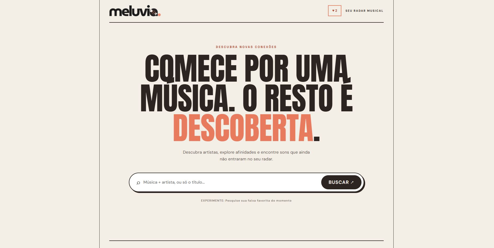
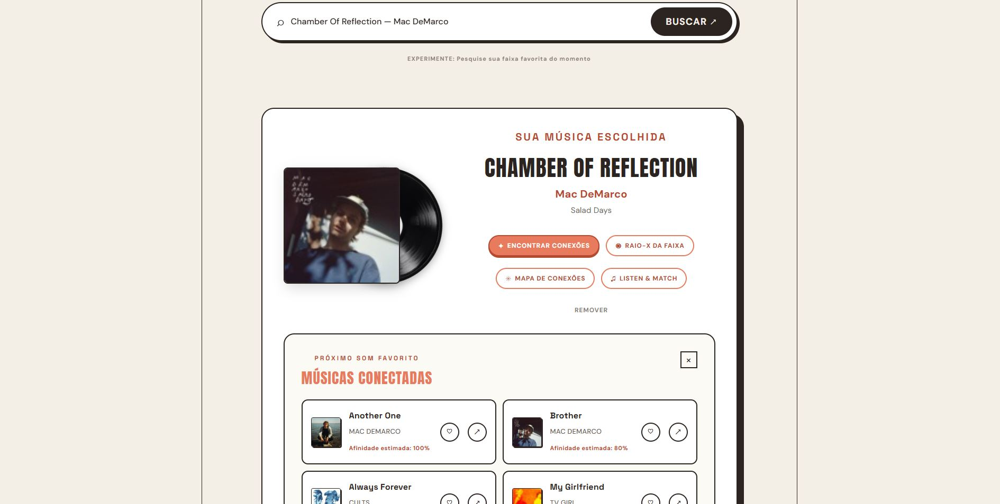
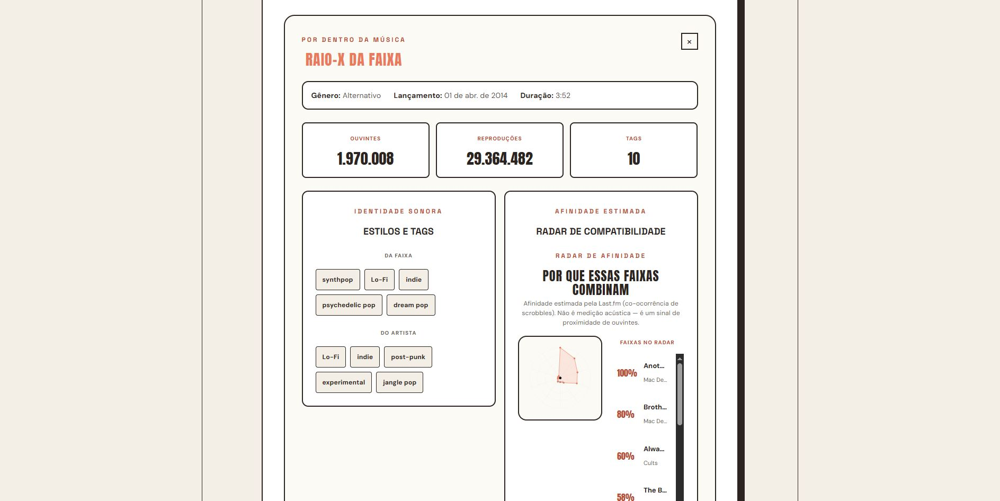
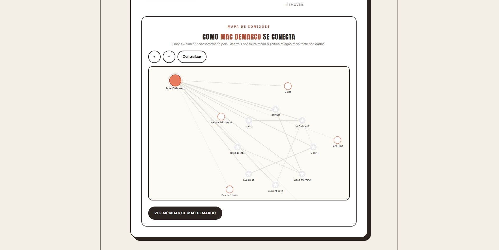
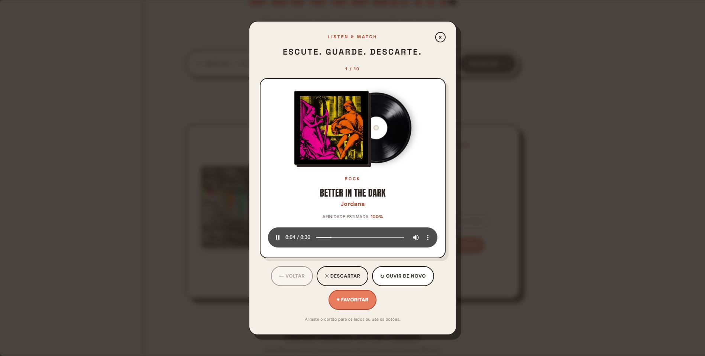
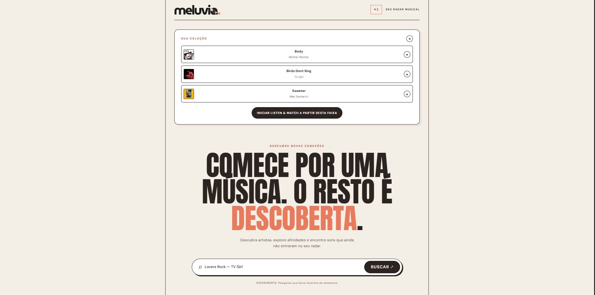

# 💿 `Meluvia: Radar de Descobertas Musicais`


> Este projeto foi desenvolvido para fins de estudo, prática de desenvolvimento web e composição de portfólio. O objetivo principal foi explorar a integração de APIs REST externas, manipular dados assíncronos e criar interfaces interativas de alta performance, aplicando conceitos modernos de desenvolvimento frontend e backend em um ecossistema focado na descoberta musical e exploração visual de conexões entre artistas e faixas.

Este repositório contém o código-fonte da aplicação web *Meluvia*, desenvolvida com **React**, **TypeScript**, **Vite** e um servidor backend próprio em **Express**. O sistema foca em proporcionar uma experiência imersiva de exploração musical, combinando um catálogo visual de vinis, radar de compatibilidade, mapa interativo de conexões e um fluxo dinâmico estilo *discovery* ("Listen & Match").

---

## 💡 `Sobre a Plataforma`

O *Meluvia* foi projetado para oferecer controle e transparência sobre como diferentes músicas e artistas se conectam, contando com os seguintes módulos:

- **Busca de Músicas e Catálogo em Vinil:** Pesquisa dinâmica em tempo real com auto-completar e exibição interativa das capas no formato de discos de vinil.
- **Encontrar Conexões (Descoberta Direta):** Algoritmo de recomendação com paginação e exclusão de faixas rejeitadas para navegação sem repetições.
- **Raio-X da Faixa (Análise Musical):** Mapeamento detalhado contendo contagem de ouvintes/scrobbles, tags de estilo e um **Radar Radial SVG** de afinidade acústica/audiência.
- **Mapa de Conexões Interativo:** Visualização em teia gráfica (SVG interativo com zoom e pan) exibindo relações em anéis concêntricos entre o artista pesquisado e seus pares.
- **Modo Listen & Match:** Experiência interativa de descoberta rápida de músicas com player de prévia de áudio (iTunes), sistema de aprovação/rejeição por gestos ou clique e resumo de sessão.
- **Coleção Local de Favoritos:** Persistência no navegador sem necessidade de login, garantindo salvamento imediato de faixas selecionadas.

---

## 💻 `Telas Principais`

| Tela de início | Tela de Busca de Conexões |
| :---: | :---: |
|  |  |

| Tela Raio-X da Faixa | Tela Mapa de Conexões |
| :---: | :---: |
|  |  |

| Tela Listen & Match | Telas de Favoritos |
| :---: | :---: |
|  |  |

---

## 🚀 `Como Executar o Projeto`

Para rodar a aplicação localmente, siga os passos abaixo:

1. **Clonar o Repositório e Instalar Dependências:**
   ```bash
   git clone https://github.com/seu-usuario/meluvia.git
   cd meluvia
   npm install
   ```

2. **Configurar as Variáveis de Ambiente:**
   Crie um arquivo `.env` na raiz do projeto contendo a sua chave de API da Last.fm:
   ```env
   LASTFM_API_KEY=sua_chave_aqui
   ```

3. **Iniciar a Aplicação:**
   Em ambientes de desenvolvimento, você precisará executar o servidor Backend (Express) e o Frontend (Vite):
   ```bash
   # Rodar o servidor Node/Express (Porta 3001)
   npx tsx server.ts

   # Em outro terminal, rodar o Frontend Vite (Porta 5173)
   npm run dev
   ```
4. Acesse `http://localhost:5173` no seu navegador.

---

## 🛠️ `Tecnologias e Conceitos Aplicados`

| Segmento | Stack Tecnológica | Bibliotecas, APIs e Conceitos |
| :--- | :--- | :--- |
| **Frontend UI** | React 18, TypeScript, CSS3 | Design Responsivo, Animações CSS de Vinil, Variáveis CSS, SVG Dinâmico |
| **Backend & Proxy** | Node.js, Express, TypeScript | Proxy de chamadas REST, controle de concorrência assíncrona, deduplicação |
| **APIs Externas** | Last.fm API, iTunes Search API | Consulta de Scrobbles, Tags, Mapeamento de Similares, Artwork 300x300 e Prévias de Áudio (30s) |
| **Visualização de Dados** | SVG Nativo no React | Radar Radial de Compatibilidade e Grafo em Anéis Concéntricos |
| **Persistência de Dados** | Browser LocalStorage | Armazenamento seguro de favoritos, histórico de rejeições e sessão ativa |

---

## 📁 `Estrutura do Repositório`

```text
Meluvia/
├── public/                  # Ativos públicos e favicon
├── src/                     # Código-fonte da aplicação React
│   ├── assets/              # Logos, texturas de vinil e imagens
│   ├── types/               # Definições de tipos TypeScript (interfaces de API)
│   ├── App.css              # Estilização global, temas e responsividade
│   ├── App.tsx              # Componente principal, controladores de estado e layouts
│   ├── CompatibilityRadar.tsx # Renderizador do Radar Radial em SVG
│   ├── ConnectionWeb.tsx    # Grafo interativo de conexões entre artistas
│   ├── ListenMatch.tsx      # Módulo interativo de descoberta (Listen & Match)
│   ├── musicSearch.ts       # Cliente de busca rápida via iTunes API
│   └── storage.ts           # Camada de persistência local (LocalStorage)
├── .env                     # Variáveis de ambiente (chave de API)
├── index.html               # Ponto de entrada da aplicação
├── server.ts                # Servidor Backend Express com rotas de análise, gráfico e recomendações
└── vite.config.ts           # Configurações de compilação do Vite
```